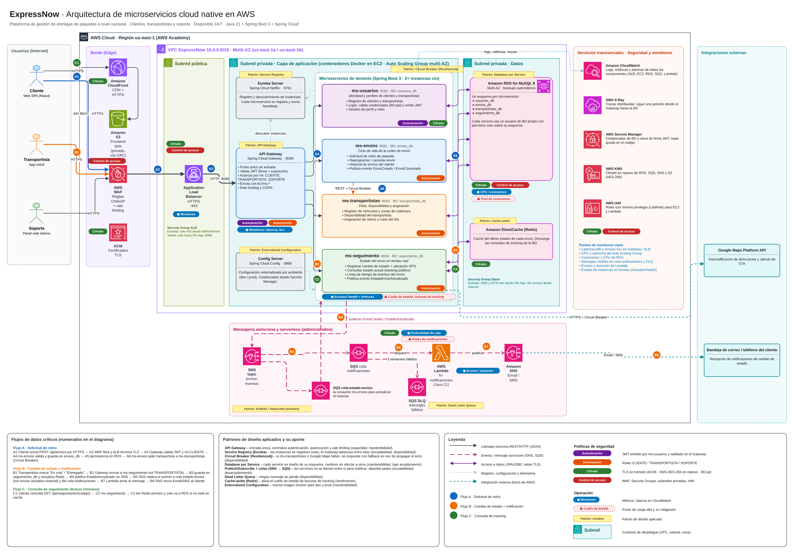

# ExpressNow · Microservicios

Plataforma de gestión de entregas de paquetes a nivel nacional para clientes, transportistas y personal de soporte.
Este repositorio contiene los **4 microservicios de dominio** definidos en el diseño de arquitectura,
desarrollados en **Java 21 + Spring Boot 3.5**, con persistencia en **MySQL (Amazon RDS)**.



> El diagrama editable está en [`docs/ExpressNow_Arquitectura.drawio`](docs/ExpressNow_Arquitectura.drawio).

---

## Contenido

1. [Microservicios](#microservicios)
2. [Estructura del repositorio](#estructura-del-repositorio)
3. [Requisitos previos](#requisitos-previos)
4. [Paso 1 · Clonar el repositorio](#paso-1--clonar-el-repositorio)
5. [Paso 2 · Preparar la base de datos](#paso-2--preparar-la-base-de-datos)
6. [Paso 3 · Compilar, testear y empaquetar con Maven](#paso-3--compilar-testear-y-empaquetar-con-maven)
7. [Paso 4 · Ejecutar los microservicios](#paso-4--ejecutar-los-microservicios)
8. [Paso 5 · Probar con Postman](#paso-5--probar-con-postman)
9. [Endpoints](#endpoints)
10. [Modelo de datos](#modelo-de-datos)
11. [Manejo de errores](#manejo-de-errores)
12. [Flujo de trabajo con Git](#flujo-de-trabajo-con-git)

---

## Microservicios

| Microservicio | Puerto | Esquema BD | Responsabilidad |
| --- | --- | --- | --- |
| `ms-usuarios` | 8081 | `usuarios_db` | Registro de clientes, transportistas y soporte; direcciones; login (contraseñas con BCrypt) |
| `ms-envios` | 8082 | `envios_db` | Solicitud de retiro, reprogramación, cancelación, cambios de estado e historial del envío |
| `ms-transportistas` | 8083 | `transportistas_db` | Flota, vehículos, disponibilidad y asignación de retiros |
| `ms-seguimiento` | 8084 | `seguimiento_db` | Estado en tiempo real y línea de tiempo de eventos (tracking público por código) |

Decisiones de diseño aplicadas en el código:

- **Arquitectura en capas** en cada servicio: `controller` → `service` (interfaz + implementación) → `repository` → `model`, más `dto` y `exception`.
- **Database per Service**: cada microservicio tiene su propio esquema y su propio usuario de base de datos. No hay claves foráneas entre esquemas; las referencias entre servicios (`clienteId`, `envioId`, `transportistaId`) son lógicas.
- **Circuit Breaker (Resilience4j)**: `ms-envios` llama a `ms-transportistas` para asignar un transportista. Si `ms-transportistas` está caído o no hay transportistas libres, el envío igual se crea y queda `PENDIENTE_ASIGNACION`, en lugar de fallar.
- **Validación** de entrada con Bean Validation y **errores con formato único** (400, 401, 404, 405, 409, 500).
- **Documentación OpenAPI**: cada servicio publica Swagger UI en `http://localhost:<puerto>/swagger-ui.html`.
- **Monitoreo**: `http://localhost:<puerto>/actuator/health` muestra el estado del servicio, de la conexión a la base de datos y del Circuit Breaker.

## Estructura del repositorio

```
expressnow-microservicios/
├── pom.xml                         # POM agregador: compila los 4 servicios con un solo comando
├── mvnw / mvnw.cmd                 # Maven Wrapper (no requiere tener Maven instalado)
├── docker-compose.yml              # MySQL local (alternativa a RDS)
├── .env.example                    # Variables de entorno para conectarse a Amazon RDS
├── database/
│   ├── 01_esquemas_y_usuarios.sql  # Crea los 4 esquemas y sus usuarios
│   └── 02_consultas_verificacion.sql
├── postman/
│   └── ExpressNow.postman_collection.json
├── docs/                           # Diagrama de arquitectura (EP1)
├── ms-usuarios/
├── ms-envios/
├── ms-transportistas/
└── ms-seguimiento/
    ├── pom.xml
    └── src/
        ├── main/java/cl/duoc/expressnow/seguimiento/
        │   ├── controller/   # Endpoints REST
        │   ├── service/      # Lógica de negocio (interfaz + implementación)
        │   ├── repository/   # Spring Data JPA
        │   ├── model/        # Entidades JPA y enums
        │   ├── dto/          # Objetos de entrada/salida con validaciones
        │   ├── exception/    # Excepciones y @RestControllerAdvice
        │   └── config/       # Configuración (OpenAPI)
        ├── main/resources/application.properties
        └── test/             # Pruebas de integración con H2
```

## Requisitos previos

| Herramienta | Versión | Para qué |
| --- | --- | --- |
| JDK | **21** | Compilar y ejecutar (verificar con `java -version`) |
| Git | cualquiera | Clonar el repositorio |
| Maven | 3.9+ (opcional) | El repo incluye `mvnw`, que descarga Maven automáticamente |
| Base de datos | MySQL 8 | **Amazon RDS for MySQL** (AWS Academy) o Docker Desktop para MySQL local |
| Postman | cualquiera | Probar los endpoints |

## Paso 1 · Clonar el repositorio

```bash
git clone https://github.com/<usuario>/expressnow-microservicios.git
cd expressnow-microservicios
```

## Paso 2 · Preparar la base de datos

Elige **una** de las dos opciones.

### Opción A · Amazon RDS for MySQL (AWS Academy Learner Lab)

1. En AWS Academy abre el **Learner Lab**, presiona **Start Lab** y espera el indicador verde. Luego entra a la consola con **AWS**.
2. Ve a **RDS → Create database** y configura:
   - *Standard create* · Engine: **MySQL** (8.0 u 8.4)
   - Template: **Free tier** o **Dev/Test**
   - DB instance identifier: `expressnow-db`
   - Master username: `admin` · Master password: la que elijas
   - Instance class: `db.t3.micro`
   - Storage: 20 GB gp2/gp3
   - Connectivity → **Public access: Yes** (para conectarte desde tu PC durante el desarrollo)
   - VPC security group: **Create new** → `expressnow-db-sg`
3. Cuando el estado sea **Available**, abre la instancia y copia el **Endpoint** (por ejemplo `expressnow-db.abc123xyz.us-east-1.rds.amazonaws.com`).
4. En **Connectivity & security → VPC security groups → Inbound rules → Edit**, agrega la regla **MySQL/Aurora · TCP 3306 · Source: My IP**. Así solo tu IP puede conectarse.
5. Conéctate con MySQL Workbench (o DBeaver) usando el endpoint, el puerto 3306 y el usuario `admin`. Ejecuta [`database/01_esquemas_y_usuarios.sql`](database/01_esquemas_y_usuarios.sql), **cambiando antes las contraseñas** `..._local` por contraseñas seguras.

> En Learner Lab la sesión dura unas horas; al terminar, el laboratorio detiene los recursos. Antes de probar, presiona **Start Lab** otra vez y espera a que la instancia RDS vuelva a estar *Available*. El endpoint no cambia.

### Opción B · MySQL local con Docker

```bash
docker compose up -d
```

Levanta MySQL 8.4 en `localhost:3306` y ejecuta automáticamente `database/01_esquemas_y_usuarios.sql`.
Los valores por defecto de `application.properties` ya apuntan a esta base, así que no necesitas configurar nada más.

> **Las tablas no se crean con SQL.** Hibernate las genera a partir de las entidades JPA cuando cada microservicio arranca (`spring.jpa.hibernate.ddl-auto=update`).

## Paso 3 · Compilar, testear y empaquetar con Maven

Desde la raíz del repositorio (el POM agregador construye los 4 servicios):

```bash
# Linux / macOS
./mvnw clean install

# Windows (PowerShell o CMD)
mvnw.cmd clean install
```

Si tienes Maven instalado, puedes usar `mvn` en lugar de `./mvnw`.

| Comando | Qué hace |
| --- | --- |
| `mvn clean` | Borra la carpeta `target/` |
| `mvn compile` | Descarga las dependencias y compila |
| `mvn test` | Ejecuta las pruebas de integración (usan H2 en memoria, **no requieren MySQL**) |
| `mvn package` | Genera el `.jar` ejecutable en `target/` |
| `mvn install` | Todo lo anterior y además instala el artefacto en el repositorio local `~/.m2` |
| `mvn package -DskipTests` | Empaqueta sin correr las pruebas |

Al terminar se generan:

```
ms-usuarios/target/ms-usuarios.jar
ms-envios/target/ms-envios.jar
ms-transportistas/target/ms-transportistas.jar
ms-seguimiento/target/ms-seguimiento.jar
```

Para construir **un solo** servicio: `./mvnw -pl ms-envios clean package` desde la raíz, o `mvn clean package` dentro de su carpeta.

## Paso 4 · Ejecutar los microservicios

Abre **una terminal por servicio**. Arranca primero `ms-transportistas`, porque `ms-envios` lo llama al crear un envío.

### Con MySQL local (opción B)

```bash
java -jar ms-transportistas/target/ms-transportistas.jar
java -jar ms-usuarios/target/ms-usuarios.jar
java -jar ms-envios/target/ms-envios.jar
java -jar ms-seguimiento/target/ms-seguimiento.jar
```

También funciona `./mvnw -pl ms-usuarios spring-boot:run`, o ejecutar la clase `Ms...Application` desde el IDE.

### Con Amazon RDS (opción A)

Cada servicio lee la conexión desde variables de entorno. Ejemplo para `ms-usuarios`; repite el comando con el usuario y la contraseña de cada servicio:

```bash
# Linux / macOS
export DB_HOST=expressnow-db.abc123xyz.us-east-1.rds.amazonaws.com
export DB_SSL_MODE=REQUIRED
DB_USER=ms_usuarios DB_PASSWORD='tu_password' java -jar ms-usuarios/target/ms-usuarios.jar
```

```powershell
# Windows PowerShell
$env:DB_HOST="expressnow-db.abc123xyz.us-east-1.rds.amazonaws.com"
$env:DB_SSL_MODE="REQUIRED"
$env:DB_USER="ms_usuarios"; $env:DB_PASSWORD="tu_password"
java -jar ms-usuarios/target/ms-usuarios.jar
```

| Variable | Por defecto | Descripción |
| --- | --- | --- |
| `DB_HOST` | `localhost` | Host de MySQL o endpoint de RDS |
| `DB_PORT` | `3306` | Puerto |
| `DB_NAME` | `<servicio>_db` | Esquema |
| `DB_USER` / `DB_PASSWORD` | `ms_<servicio>` / `ms_<servicio>_local` | Credenciales del servicio |
| `DB_SSL_MODE` | `PREFERRED` | Usar `REQUIRED` con RDS (conexión cifrada con TLS) |
| `SERVER_PORT` | 8081–8084 | Puerto HTTP |
| `TRANSPORTISTAS_URL` | `http://localhost:8083` | Solo `ms-envios`: URL de `ms-transportistas` |

Para comprobar que cada servicio levantó y se conectó a la base de datos, revisa `http://localhost:8081/actuator/health` (cambia el puerto para cada servicio). Debe responder `"status": "UP"` y `"db": {"status": "UP"}`.

## Paso 5 · Probar con Postman

1. En Postman ve a **Import** y elige `postman/ExpressNow.postman_collection.json`.
2. Con los 4 servicios arriba, ejecuta las carpetas **en orden**, o la colección completa con **Run collection**.
   Cada request guarda en variables los ids que usan los siguientes (`clienteId`, `envioId`, `codigoSeguimiento`...).
3. La colección tiene **54 requests con tests automáticos**. Incluye casos exitosos (200, 201, 204) y de error (400, 401, 404, 409).

Para verificar en la base de datos lo que hicieron los requests, usa las consultas de [`database/02_consultas_verificacion.sql`](database/02_consultas_verificacion.sql).

## Endpoints

Todas las rutas tienen el prefijo `/api/v1`.

### ms-usuarios · `:8081`

| Método | Ruta | Descripción | Respuestas |
| --- | --- | --- | --- |
| GET | `/usuarios?tipo=CLIENTE` | Lista usuarios (filtro opcional) | 200 |
| GET | `/usuarios/{id}` | Obtiene un usuario con sus direcciones | 200, 404 |
| POST | `/usuarios` | Registra un usuario | 201, 400, 409 |
| PUT | `/usuarios/{id}` | Actualiza el perfil | 200, 400, 404, 409 |
| DELETE | `/usuarios/{id}` | Elimina el usuario y sus direcciones | 204, 404 |
| GET | `/usuarios/{id}/direcciones` | Lista direcciones | 200, 404 |
| POST | `/usuarios/{id}/direcciones` | Agrega una dirección | 201, 400, 404 |
| DELETE | `/usuarios/{id}/direcciones/{direccionId}` | Elimina una dirección | 204, 404 |
| POST | `/usuarios/login` | Valida email y contraseña | 200, 401 |

### ms-transportistas · `:8083`

| Método | Ruta | Descripción | Respuestas |
| --- | --- | --- | --- |
| GET | `/transportistas?disponible=true&comuna=Providencia` | Lista transportistas (filtros opcionales) | 200 |
| GET | `/transportistas/{id}` | Obtiene un transportista con sus vehículos | 200, 404 |
| POST | `/transportistas` | Registra un transportista | 201, 400, 409 |
| PUT | `/transportistas/{id}` | Actualiza datos | 200, 400, 404, 409 |
| PATCH | `/transportistas/{id}/disponibilidad` | Cambia la disponibilidad | 200, 404 |
| DELETE | `/transportistas/{id}` | Elimina (solo si no tiene asignaciones activas) | 204, 404, 409 |
| GET / POST | `/transportistas/{id}/vehiculos` | Lista o agrega vehículos | 200 / 201, 400, 409 |
| DELETE | `/transportistas/{id}/vehiculos/{vehiculoId}` | Elimina un vehículo | 204, 404 |
| POST | `/asignaciones` | Asigna un envío al primer transportista disponible (lo invoca `ms-envios`) | 201, 400, 409 |
| GET | `/asignaciones?transportistaId=1` | Lista asignaciones | 200 |
| GET | `/asignaciones/{id}` | Obtiene una asignación | 200, 404 |
| PATCH | `/asignaciones/{id}/completar` · `/cancelar` | Cierra una asignación | 200, 404, 409 |

### ms-envios · `:8082`

| Método | Ruta | Descripción | Respuestas |
| --- | --- | --- | --- |
| GET | `/envios?clienteId=1&estado=ASIGNADO` | Lista envíos (filtros opcionales) | 200, 400 |
| GET | `/envios/{id}` | Obtiene un envío con sus paquetes | 200, 404 |
| GET | `/envios/codigo/{codigo}` | Obtiene un envío por código de seguimiento | 200, 404 |
| POST | `/envios` | Solicitud de retiro: crea el envío, calcula el costo y pide transportista | 201, 400 |
| PUT | `/envios/{id}` | Corrige datos de destino (antes del retiro) | 200, 400, 404, 409 |
| PATCH | `/envios/{id}/reprogramar` | Cambia la fecha de retiro | 200, 400, 404, 409 |
| PATCH | `/envios/{id}/cancelar` | Cancela (antes del retiro) | 200, 400, 404, 409 |
| PATCH | `/envios/{id}/estado` | Cambio de estado operativo, validando transiciones | 200, 400, 404, 409 |
| POST | `/envios/{id}/asignacion` | Reintenta asignar transportista a un envío pendiente | 200, 404, 409 |
| GET | `/envios/{id}/historial` | Historial de estados | 200, 404 |
| DELETE | `/envios/{id}` | Elimina un envío cancelado | 204, 404, 409 |

Transiciones de estado válidas:

```
SOLICITADO ──► ASIGNADO ──► RETIRADO ──► EN_RUTA ──► ENTREGADO
     │            ▲   │
     ▼            │   └──► CANCELADO
PENDIENTE_ASIGNACION ─────► CANCELADO
```

Costo del envío: `$2.990 + $990 por kg` (peso total redondeado hacia arriba).

### ms-seguimiento · `:8084`

| Método | Ruta | Descripción | Respuestas |
| --- | --- | --- | --- |
| GET | `/seguimientos?estado=EN_RUTA` | Lista seguimientos | 200 |
| GET | `/seguimientos/{id}` | Obtiene un seguimiento con su línea de tiempo | 200, 404 |
| GET | `/seguimientos/codigo/{codigo}` | Tracking público por código | 200, 404 |
| GET | `/seguimientos/envio/{envioId}` | Seguimiento de un envío | 200, 404 |
| POST | `/seguimientos` | Abre el seguimiento de un envío | 201, 400, 409 |
| DELETE | `/seguimientos/{id}` | Elimina el seguimiento y sus eventos | 204, 404 |
| GET | `/seguimientos/{id}/eventos` | Lista los eventos | 200, 404 |
| POST | `/seguimientos/{id}/eventos` | Registra un cambio de estado con ubicación GPS | 201, 400, 404, 409 |
| PUT | `/seguimientos/{id}/eventos/{eventoId}` | Corrige la descripción o ubicación de un evento | 200, 400, 404 |
| DELETE | `/seguimientos/{id}/eventos/{eventoId}` | Elimina un evento registrado por error | 204, 404, 409 |

## Modelo de datos

Relaciones JPA de cada servicio (`@OneToMany(mappedBy=...)` en el padre y `@ManyToOne` + `@JoinColumn` en el hijo, con `cascade = ALL` y `orphanRemoval = true`):

| Servicio | Padre | 1 ─ N | Hijo |
| --- | --- | --- | --- |
| ms-usuarios | `Usuario` | ─► | `Direccion` |
| ms-transportistas | `Transportista` | ─► | `Vehiculo` |
| ms-transportistas | `Transportista` | ─► | `Asignacion` |
| ms-envios | `Envio` | ─► | `Paquete` |
| ms-envios | `Envio` | ─► | `HistorialEstado` |
| ms-seguimiento | `Seguimiento` | ─► | `EventoSeguimiento` |

## Manejo de errores

Todos los servicios responden los errores con el mismo formato:

```json
{
  "timestamp": "2026-10-24T10:15:30",
  "status": 400,
  "error": "Bad Request",
  "mensaje": "La solicitud tiene campos inválidos",
  "path": "/api/v1/usuarios",
  "detalles": {
    "email": "El email no tiene un formato válido",
    "rut": "El RUT debe tener el formato 12345678-9"
  }
}
```

| Código | Cuándo |
| --- | --- |
| 400 | Validación de campos, JSON mal formado, parámetro con tipo inválido |
| 401 | Login con credenciales incorrectas |
| 404 | Recurso o ruta inexistente |
| 405 | Método HTTP no soportado en la ruta |
| 409 | Regla de negocio (email duplicado, transición de estado inválida, eliminar con dependencias activas) |
| 500 | Error no controlado (se registra en el log) |

## Flujo de trabajo con Git

Se usa una variante de **Git Flow**:

| Rama | Uso |
| --- | --- |
| `main` | Versiones estables y entregables (etiquetadas, por ejemplo `v1.0.0`) |
| `develop` | Integración de las funcionalidades terminadas |
| `feature/<nombre>` | Una rama por funcionalidad o microservicio; se integra a `develop` con merge `--no-ff` |

Los mensajes de commit siguen **Conventional Commits** en español: `feat:`, `fix:`, `test:`, `docs:`, `chore:`, `build:`.

```bash
git log --oneline --graph --all   # ver el historial de ramas
```

---

Proyecto académico · JVY0101 Java: Diseño y Construcción de Soluciones Nativas en Nube · Duoc UC
